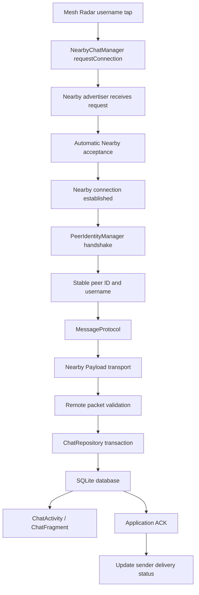
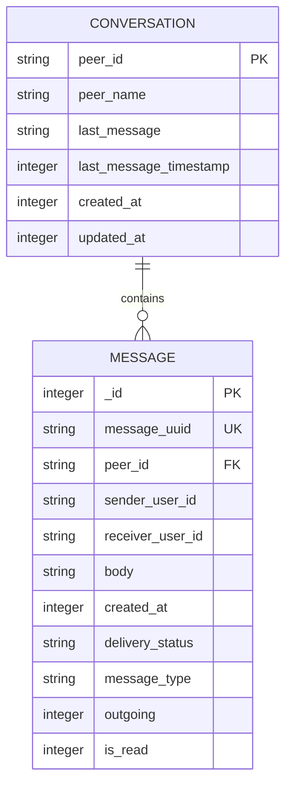

# Messaging Architecture

## Component flow

## Responsibilities

- `NearbyDiscoveryManager` advertises and discovers using the shared Nearby client. It does not initiate connections.
- `NearbyChatManager` requests connections after a username tap, automatically accepts initiated requests, opens ChatActivity only on the initiating device, sends protocol envelopes, verifies inbound sender IDs against the connected endpoint, and coordinates message persistence/ACK flow.
- `PeerIdentityManager` reads the saved profile username and persistent per-install ID and maps temporary endpoint IDs to stable IDs only for active connections.
- `PeerAvatarStore` compresses local profile photos into bounded JPEG metadata, validates received avatars against the connected peer identity, and persists them in private storage keyed by stable user ID.
- `MessageProtocol` handles versioned UTF-8 JSON with packet type, message ID, sender/recipient IDs, timestamp, payload, and optional ACK reference. It rejects unsupported versions, malformed packets, invalid IDs, and oversized text/packets.
- `PendingMessageManager` relies on SQLite as the source of pending messages and applies bounded retry/backoff.
- `ChatRepositoryImpl` owns the single-thread database executor and transaction boundaries. UI code does not execute SQL.
- `ChatFragment` lists conversations and refreshes unread indicators. `ChatActivity` marks incoming messages read while active and observes the active peer's history and messaging callbacks. `ChatNotifications` posts a notification only after an unread incoming message has been persisted.

## Database relationships

`peer_id` stores the stable remote user ID for new conversations; it is not the Nearby endpoint ID or username. `message_uuid` deduplicates transport retries. Schema v3 adds `is_read` in place; old messages migrate as read, while new incoming messages are unread until their conversation is opened. Conversation queries sort by unread count first and then latest activity.

Avatars are separate bounded protocol packets, not message content or general file transfers. They are stored in app-private files and indexed by the peer's stable user ID.

## Protocol and trust

Packets are capped at 16 KiB, text at 4,000 characters, and peer-path metadata at a bounded number of nodes. The receiver checks the connected endpoint's exchanged stable ID and recipient ID, persists the message, then ACKs. Duplicate IDs are ignored and re-ACKed. Nearby payload success is only `SENT`; `DELIVERED` requires the matching application ACK.

Nearby connections are automatically accepted without manual authentication-token comparison. Usernames are not proof of identity, and this prototype has no public-key identity, account verification, key recovery, or E2E encryption. It does not relay message packets or files through other peers.
