# System Overview

## Application shell

`MainActivity` hosts the bottom navigation and the active feature fragment. The four destinations are Mesh, Chat, Files, and Profile. Destination fragments are added once and hidden or shown when navigation changes. A peer-specific chat can also be opened through `MainActivity.openConversation(peerId, displayName)`.

## Discovery architecture

`MainActivity` checks Google Play Services, runtime permissions, Bluetooth hardware, and Bluetooth activation state. It starts one `DiscoveryForegroundService`, which keeps the application-scoped `NearbyDiscoveryManager` active while the app is backgrounded.

`NearbyDiscoveryManager` advertises and discovers with `Strategy.P2P_CLUSTER` and the application package service ID. It owns a thread-safe endpoint registry, connects to direct peers, and exchanges bounded in-memory peer paths. `MeshFragment` listens only for UI updates, and `RefreshRadar` renders the resulting tree. No database participates in discovery or topology exchange.

```mermaid
flowchart LR
    A[Application startup] --> B[Google Play Services check]
    B --> C[Permission checks]
    C --> D[Bluetooth activation]
    D --> E[Advertising + Discovery]
    E --> F[Endpoint callbacks]
    F --> G[Thread-safe endpoint registry]
    G --> H[Automatic Nearby connections]
    H --> I[Peer path exchange]
    I --> J[Peer topology]
    J --> K[MeshFragment callbacks]
    K --> L[RefreshRadar tree]
```

## Feature boundaries

- Mesh discovers direct Nearby endpoints, connects to them, and exchanges display-name topology while foregrounded or backgrounded through its service. It does not route messages or files.
- Chats use an application-scoped `MeshDropDatabase` (`SQLiteOpenHelper`) with conversation/message DAOs, entities, and a repository. Repository operations run on a single worker thread and return callbacks on the main thread. There is no network transport or incoming-message path connected to the UI.
- Profile field values and the selected avatar URI are stored in the `profile` SharedPreferences file. The cropped image itself is in the app's private files directory.
- Appearance is stored in the `appearance` SharedPreferences file and applied with `AppCompatDelegate`.
- Files currently presents an empty state; no transfer service or transfer database is connected.

## Persistence and privacy

SQLite, SharedPreferences, and the app-private files directory are local to the app installation. Chat content and profile data are not synced to another device or account. Clearing app data removes these local records and the avatar file.

## Main implementation locations

- Activity and navigation: `app/src/main/java/com/meshdrop/ui/activity/MainActivity.java`
- Feature screens: `app/src/main/java/com/meshdrop/ui/fragment/`
- Database initialization: `app/src/main/java/com/meshdrop/database/MeshDropDatabase.java`
- Chat persistence: `app/src/main/java/com/meshdrop/database/dao/` and `app/src/main/java/com/meshdrop/database/repository/`
- Chat models: `app/src/main/java/com/meshdrop/data/model/`
- Theme preference: `app/src/main/java/com/meshdrop/ui/activity/ThemePreferences.java`
- Layouts and palettes: `app/src/main/res/layout/`, `app/src/main/res/values/`, and `app/src/main/res/values-night/`
