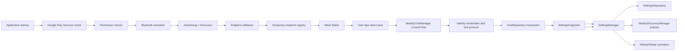

# System Overview

## Application shell

`MainActivity` hosts the bottom navigation and the active feature fragment. The four destinations are Mesh, Chat, Files, and Profile. Destination fragments are added once and hidden or shown when navigation changes. A peer-specific chat can also be opened through `MainActivity.openConversation(peerId, displayName)`.

## Discovery architecture

`MainActivity` checks Google Play Services, runtime permissions, Bluetooth hardware, and Bluetooth activation state. It starts one `DiscoveryForegroundService`, which keeps the application-scoped `NearbyDiscoveryManager` active while the app is backgrounded.

`NearbyDiscoveryManager` advertises and discovers with `Strategy.P2P_CLUSTER` and the application package service ID. It owns the temporary endpoint registry and does not connect or accept peers automatically. `MeshFragment` renders direct endpoints and hands taps to `NearbyChatManager`.

## Messaging architecture

`NearbyChatManager` reuses Nearby Connections for explicit user-approved direct connections, identity handshakes, text payloads, and application acknowledgements. `PeerIdentityManager` maps temporary endpoint IDs to a persistent per-install user ID and profile username. `MessageProtocol` validates versioned bounded JSON packets. `ChatRepositoryImpl` persists messages and conversation previews in the existing SQLite database; `ChatFragment` lists conversations and `ChatActivity` displays the live thread. See [messaging-architecture.md](messaging-architecture.md) for protocol and trust details.

## Settings architecture

`SettingsFragment` is opened from the Profile screen below Mesh Overview, preserving the four-item bottom navigation. `SettingsRepository` persists values in `meshdrop_settings`; `SettingsManager` supplies defaults and notifies listeners. The `NearbyDiscoveryManager` applies Force Scan, scan duty cycle, advertising visibility, anonymous public names, battery policy, and peer-notification preference without duplicating Nearby sessions. `RefreshRadar` applies visual animation preferences independently from discovery.

## Feature boundaries

- Mesh discovers direct Nearby endpoints; chat connections start only after a user taps a peer and both users accept. Messages are direct only and are not relayed.
- Chats use the application-scoped `MeshDropDatabase` (`SQLiteOpenHelper`) with conversation/message DAOs, entities, and a repository. Repository operations run on a single worker thread. Nearby payloads carry direct text packets and ACKs; file transfer and multi-hop messaging are absent.
- Profile field values and the selected avatar URI are stored in the `profile` SharedPreferences file. The cropped image itself is in the app's private files directory.
- Appearance is stored in the `appearance` SharedPreferences file and applied with `AppCompatDelegate`.
- Files currently presents an empty state; no transfer service or transfer database is connected.

## Persistence and privacy

SQLite, SharedPreferences, and the app-private files directory are local to the app installation. Chat content and profile data are not synced to another device or account. Clearing app data removes these local records and the avatar file.

## Main implementation locations

- Activity and navigation: `app/src/main/java/com/meshdrop/ui/activity/MainActivity.java`
- Feature screens: `app/src/main/java/com/meshdrop/ui/fragment/`
- Database initialization: `app/src/main/java/com/meshdrop/database/MeshDropDatabase.java`
- Chat persistence: `app/src/main/java/com/meshdrop/database/dao/` and `app/src/main/java/com/meshdrop/database/repository/`
- Chat models: `app/src/main/java/com/meshdrop/data/model/`
- Theme preference: `app/src/main/java/com/meshdrop/ui/activity/ThemePreferences.java`
- Layouts and palettes: `app/src/main/res/layout/`, `app/src/main/res/values/`, and `app/src/main/res/values-night/`
